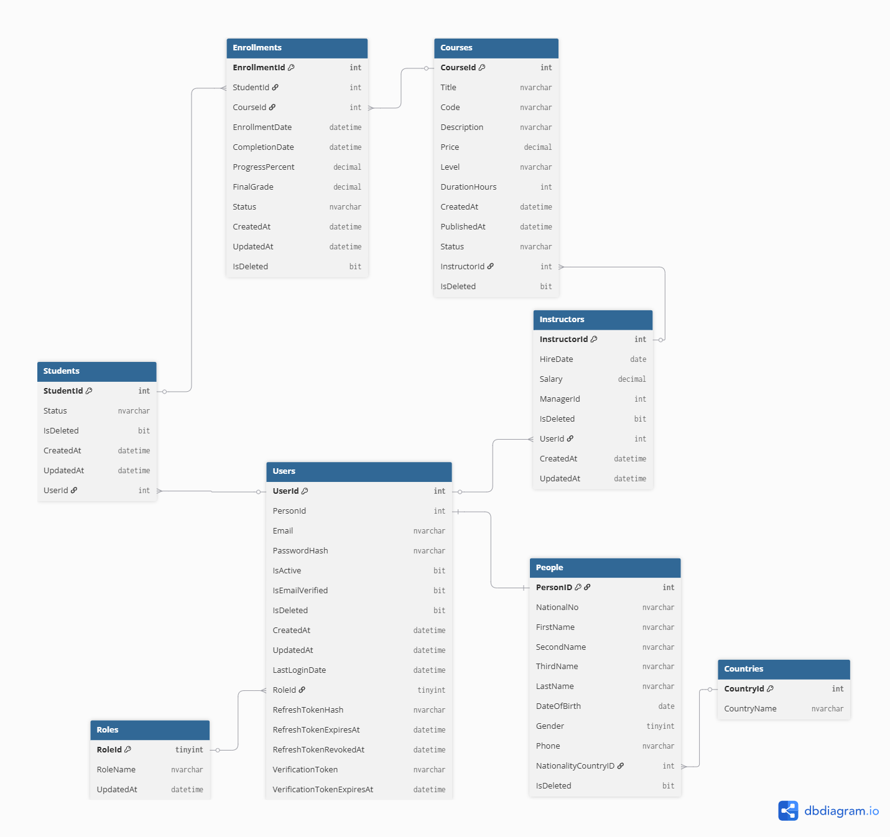

# 🚀 Training Center Management System
**ASP.NET Core Web API | Clean Architecture | SQL Server | Redis**

---

## 📌 Overview
The Training Center Management System is a backend Web API built with ASP.NET Core following Clean Architecture principles.

The system simulates a real training center where students, instructors, and administrators interact through a secure and scalable backend.

The project focuses on maintainability, separation of concerns, and scalable backend design.

---

## 📊 Project Metrics

| Metric | Count |
|---|---|
| Endpoints | 60+ |
| Database Entities | 8 |
| DTOs | 37 |
| Validators | 23 |

---

## 🏗️ System Architecture
The solution is divided into 4 layers:

- **API Layer** (`TrainingCenterMS`): Controllers, Global Exception Middleware, validation filters
- **Business Layer** (`TrainingCenter.Business`): Business logic, services, FluentValidation, authorization policies and handlers
- **Core Layer** (`TrainingCenter`): Entities, DTOs, interfaces, custom exceptions
- **Data Access Layer** (`TrainingCenter_DataAccess`): Repositories, Unit of Work, EF Core

The layers communicate through dependency injection and interface-driven design to keep coupling loose.



---

## ⚙️ Key Features
- JWT Authentication with Refresh Token support
- Role-Based Authorization (RBAC)
- Policy-Based Authorization (owner-or-admin resource handlers)
- Global Exception Handling Middleware
- FluentValidation per DTO
- Rate Limiting for API protection (per-endpoint rules)
- Redis Caching for performance optimization
- Email verification and OTP flows
- Asynchronous programming (async/await)

---

## 📧 External Services
- SMTP Email Service (Gmail integration)

---

## 🧰 Technology Stack
- ASP.NET Core Web API (.NET 8)
- C#
- Entity Framework Core
- SQL Server
- Redis
- JWT Authentication
- FluentValidation
- Swagger
- Docker

---

## 🚀 Getting Started

### Prerequisites
- .NET 8 SDK
- SQL Server (Express edition works)
- Redis (locally, or via Docker: `docker run -p 6379:6379 redis`)

### Setup
1. Clone the repository.
2. Configure your local settings with [User Secrets](https://learn.microsoft.com/aspnet/core/security/app-secrets) or environment variables (never commit real secrets):
   - `ConnectionStrings:DefaultConnection` - your SQL Server connection string
   - `JwtSettings:SecretKey` - a long random key
   - `EmailSettings:Email` and `EmailSettings:Password` - a Gmail address and its [app password](https://myaccount.google.com/apppasswords)
   - `Redis:ConnectionString` - e.g. `localhost:6379`
3. Create the `TrainingCenterDB` database (see `database-schema.png` for the ERD).
4. Run the API:
   ```
   dotnet run --project TrainingCenterMS
   ```
5. Open the Swagger UI at `/swagger` to explore and test the endpoints.

### 🐳 Docker
A `Dockerfile` is included at the repository root for containerized builds.

---

## 🚀 Deployment
Deployed on SmarterASP.NET with production-ready configuration and HTTPS enabled.

---

## 🎯 Project Goal
To demonstrate backend engineering skills including system design, clean architecture, security implementation, and scalable API development.

---

## 📝 Notes
This project is not just CRUD operations - it represents a structured backend system built with real-world architecture principles.
